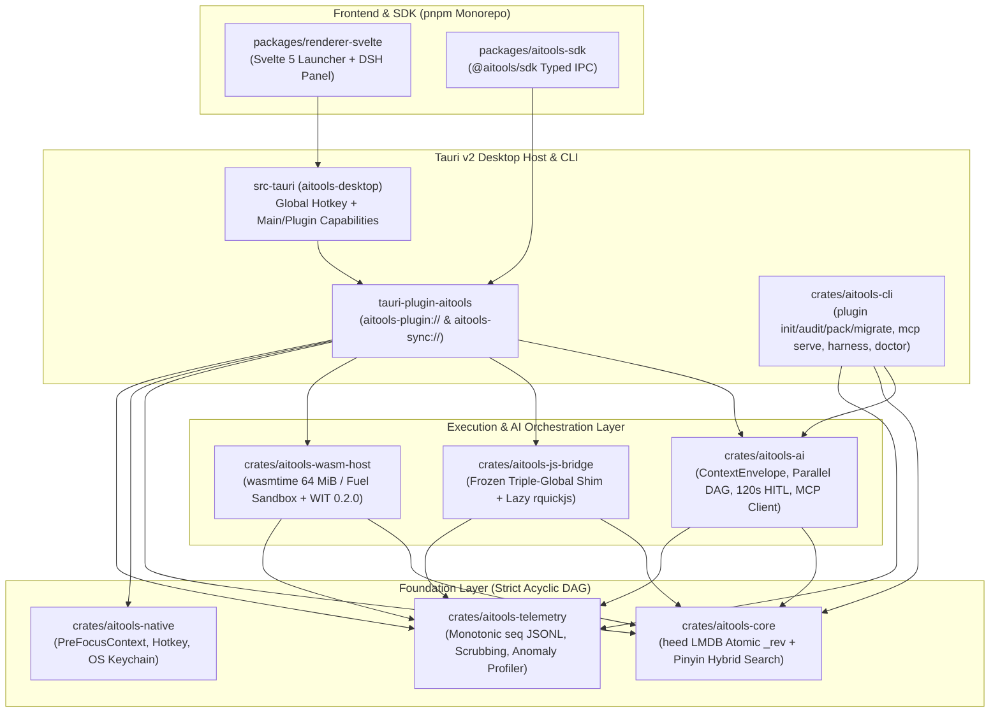

# aitools

**AI-Native Desktop Launcher & Three-Tier Plugin Ecosystem Platform**  
**AI 原生桌面效率启动器与三层插件生态平台**

`aitools` is built strictly under **Spec-Driven Development (`SPEC-000`–`SPEC-014`)** with a Rust + Tauri v2 host core, Svelte 5 dual-mode launcher & diagnostic workbench (`DSH`), sandboxed WebAssembly (`wasmtime`) execution, legacy ZTools/uTools (`rquickjs`) compatibility, and bidirectional Model Context Protocol (`MCP`) orchestration.

---

## Architecture Overview / 系统架构全景



---

## Core Performance Metrics / 核心性能基线 (`SPEC-000`)

Measured locally on Apple Silicon (`cargo bench -p aitools-core --bench wake_latency` and `pnpm tauri build`):

| Metric | `SPEC-000` Target (P50 / CI Max) | Measured Baseline |
| :--- | :--- | :--- |
| Hybrid search (1,200 features) | `<= 5 ms` | **`P50 = 389 us`**, **`P99 = 1,460 us`** |
| LMDB document lookup (`get_doc`) | `<= 300 us` / `<= 5 ms` | **`P50 = 0 us`**, **`P99 = 1 us`** |
| macOS `.app` bundle footprint | `<= 14 MiB` target | **`9.25 MiB`** |
| macOS `.dmg` release installer | `<= 18 MiB` hard ceiling | **`4.84 MiB`** |

---

## Three-Tier Plugin Ecosystem / 三层插件生态体系 (`SPEC-008`, `SPEC-012`)

| Tier | Runtime | Manifest | Built-in Plugins (`plugins/builtin/`) | Examples (`examples/plugins/`) |
| :--- | :--- | :--- | :--- | :--- |
| **Tier 1 (`legacy-compat`)** | Child Webview (`aitools-plugin://`) + `aitools-sync://` + lazy `rquickjs` + frozen `window.aitools === window.ztools === window.utools` | `plugin.json` | `snipaste-legacy`, `todo-legacy` | `legacy-color-sample` |
| **Tier 2 (`native-ui`)** | Async Tauri v2 IPC via `@aitools/sdk` (`db.*`, `ai.*`, `telemetry_log`) + `SKILL.md` | `aitools.manifest.json` | `clipboard-history`, `translation`, `terminal-launchpad`, `dev-docs-reference` | `aitools-plugin-smart-clip` |
| **Tier 3 (`rust-wasm`)** | Zero-Webview `wasmtime` sandbox (64 MiB memory cap, fuel limits, `wit/aitools-plugin.wit`) | `aitools.manifest.json` + `.wasm` | `json-codec`, `timestamp-calc` | `aitools-plugin-devtools` |

---

## 5-Minute Plugin Quickstart / 5 分钟插件开发上手

### 1. Scaffold, Audit, and Sign-Pack a Plugin

```bash
# Scaffold a Tier 2 (native-ui) or Tier 3 (rust-wasm) plugin
cargo run -p aitools-cli -- plugin init my-tool --template native-ui --dir ./my-tool

# Validate manifest schema, SKILL.md, bundle size (< 10 MB), and permissions
cargo run -p aitools-cli -- plugin audit ./my-tool

# Create a reproducible signed .atp archive using your Ed25519 key
cargo run -p aitools-cli -- plugin pack ./my-tool --out my-tool.atp --sign ~/.aitools/release-key.pem
```

### 2. Migrate a Legacy v1 uTools/ZTools Plugin (`SPEC-012-R4`)

```bash
# Generates aitools.manifest.json, SKILL.md, and MIGRATION_REPORT.md (flags any .node addons)
cargo run -p aitools-cli -- plugin migrate ./legacy-plugin --out ./migrated-plugin
```

### 3. Minimal `@aitools/sdk` Example (Tier 2)

```ts
import aitools from '@aitools/sdk';

aitools.onContextEnter(async (ctx) => {
  await aitools.log.info('hydrated selection', { traceId: ctx.trace_id });
  await aitools.db.put({ _id: `clip:${Date.now()}`, text: ctx.selection?.raw_text ?? '' });
});
```

---

## Bidirectional MCP Integration / 双向 MCP 接入

### Expose `aitools` Tools to External Clients (Claude Code, Codex, Cursor)

```bash
cargo run -p aitools-cli -- mcp serve --transport stdio
```

Example MCP client configuration:

```json
{
  "mcpServers": {
    "aitools": {
      "command": "aitools",
      "args": ["mcp", "serve", "--transport", "stdio"]
    }
  }
}
```

`aitools mcp serve` supports `initialize`, `tools/list`, `tools/call` (with `PolicyGuard` Tier 1 HITL enforcement and structured `ErrorObservation`), and `resources/read` (`aitools://harness`, `aitools://context/current`, `aitools://telemetry/anomalies`).

### Consume External MCP Servers (`mcp_servers.json`)

Place `<app_data_dir>/mcp_servers.json` using standard `mcpServers` entries; `aitools-ai` (`mcp_client.rs`) discovers external tools with a `10,000 ms` timeout and registers them under `Tier2DestructiveOrExternal` (`PolicyGuard` HITL approval required).

---

## Shortcuts & Diagnostic Controls / 快捷键与调试工作台

| Shortcut | Mode / Window | Action |
| :--- | :--- | :--- |
| Global Hotkey (configurable) | `main` launcher | Captures `PreFocusContext` (`SPEC-001`), opens launcher with context chips & zero-query AI actions |
| `Tab` or `@` prefix | `main` search input | Switches seamlessly between `< 5 ms` hybrid launcher search and AI Agent DAG orchestration |
| `Cmd+Shift+D` | `dsh` window | Toggles the **Developer & Diagnostic Harness (DSH)** panel (live log stream, fault injector, bundle export) |
| Inline HITL Prompt | Agent session | Approves or rejects suspended `Tier1StateMutating` / `Tier2DestructiveOrExternal` DAG tool steps (`120 s` timeout) |

---

## Verification & Development Commands

```bash
cargo fmt --all --check
cargo clippy --workspace --all-targets -- -D warnings
RUSTDOCFLAGS="-D warnings" cargo doc --workspace --no-deps
cargo test --workspace
cargo bench -p aitools-core --bench wake_latency
pnpm --filter @aitools/renderer-svelte check && pnpm --filter @aitools/renderer-svelte build
./packages/renderer-svelte/node_modules/.bin/tsc -p packages/aitools-sdk/tsconfig.json --noEmit
```
